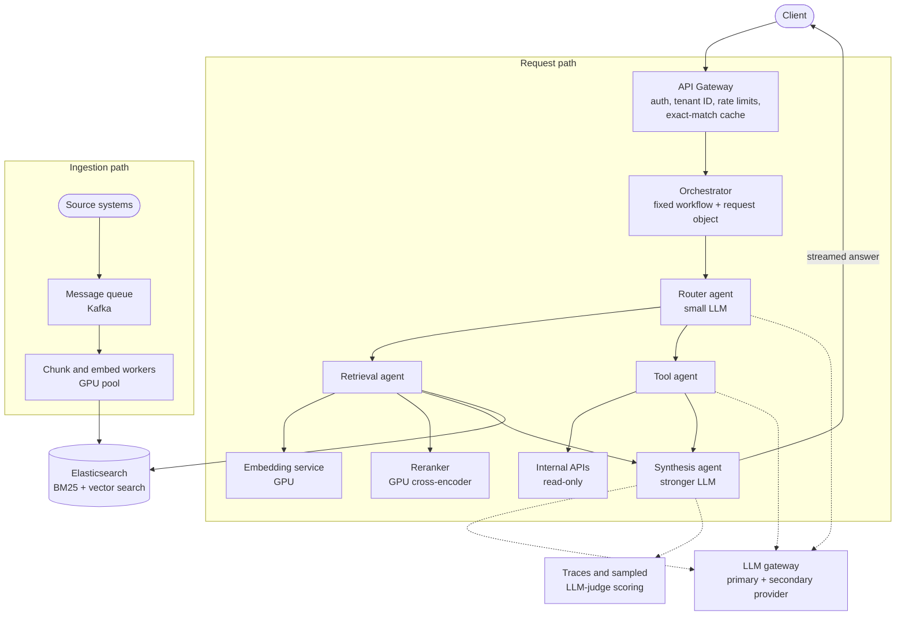

# Question 4: Multi-Agent RAG Platform at Scale

> **Reading tip.** This file is best read in a Markdown viewer (for example GitHub, or VS Code's Markdown preview with a Mermaid extension), so that the architecture diagram renders and the headings and tables are formatted for easier reading.
>
> **Authorship.** I made all of the technical and architectural decisions in this document. I used an LLM to help write it up and format it, including the Markdown syntax, the styling and the diagram.

## 1. Overview and Requirements

**Summary.** A multi-agent RAG platform for enterprise logistics support. A gateway authenticates each request and attaches the tenant ID. A fixed workflow then runs a router agent that plans the request, a retrieval agent (hybrid search over Elasticsearch) and a tool agent (internal APIs) in parallel, and a synthesis agent that streams the answer back.

**Requirements.** About 2,000 QPS at peak, p95 latency under 3 seconds, about 50M continuously updated documents, strict tenant isolation, and an SLA on answer quality.

**Key assumptions.**
- The 3-second target is time to first token. The latency budget is in 3.3.
- About 400M chunks, content that may be multilingual, and hundreds to a few thousand tenants, a few of them very large.
- Tools are read-only, there is no conversation memory, and new documents are searchable within about a minute.

**Architecture.**

## 2. Retrieval Layer

### 2.1 Embedding Model and Vector Store

**Assumptions.** About 50M documents, split into about 400M chunks. The question does not say the content is English-only, so we assume it may be multilingual.

**Embedding model: a self-hosted dense model.**
- A multilingual open-source model (such as BGE-M3 or multilingual-E5, about 1024 dimensions) on GPUs next to the search cluster. There, a small model embeds a query in about 10-30ms, a few GPUs handle 2,000 QPS, and the tenant's documents are never sent to an outside embedding service. (Only the top ~8 retrieved chunks reach the hosted LLMs.) A hosted embedding API would also add a vendor's network delay to our p95.
- We choose the model by testing 2-3 candidates on real logistics queries and picking the one that most often retrieves the right chunk. Public benchmarks are not enough.
- Each vector is stored with its model ID, because changing models means re-embedding every chunk (see 4.1).

**Vector store: Elasticsearch for vector, keyword and hybrid search.**
- One cluster does BM25 keyword search, HNSW vector search and rank fusion, so we run one system instead of two.
- Quantization (storing each vector in fewer bytes) shrinks about 1.6TB of vectors to a few hundred GB, so the index fits in memory.

**Alternatives considered.**
- *ELSER (Elastic's built-in model):* simpler, but Elastic recommends it for English text only (and a different model for other languages). On CPU ML nodes its documented speed is roughly 20-30 documents per second per node, so embedding about 400M chunks would take months on one node. It is also not tunable to logistics terms.
- *Qdrant or Milvus:* strong vector search, but they need a second system for keyword search. We would revisit them if Elasticsearch misses the latency target.

### 2.2 Index Type and Sharding

**Index type: HNSW with int8 quantization.** HNSW is a layered graph that gives the best speed and recall, and Elasticsearch supports it natively. We chose it over IVF, which searches only the nearest clusters of vectors. IVF uses less memory but needs more work to reach the same recall, and answer quality depends on recall, so we accept the memory cost.

**Memory sizing (rough estimates).** About 400M vectors at 1024 dimensions are ~1.6TB in fp32 (4 bytes per number) and ~400GB in int8 (1 byte per number), plus ~50GB of HNSW graph overhead. With one replica that is ~900GB, which must stay in memory for HNSW to be fast. That means about 15-20 data nodes with ~128GB RAM each.

**Sharding.** Each shard holds about 20-30M vectors and has at least one replica (a copy) for failover and read capacity. A query normally goes to every shard and waits for the slowest one, which threatens p95. So we route by tenant ID, and each query touches only that tenant's shards (see 2.3). Large tenants span several shards.

### 2.3 Tenant Isolation

**Assumption.** Hundreds to a few thousand tenants, a few of them very large. One index per tenant would not scale, so most tenants share indexes.

**Two tiers.**
- *Default: shared indexes with routing.* Each chunk carries a `tenant_id`, which also decides which shards store it. A tenant's queries go only to its shards, which keeps each query on fewer shards, so slow outliers matter less.
- *Large tenants: their own index.* Their load cannot affect others, and removing their data is a single index drop.

**Enforcement.**
- The API gateway reads the tenant ID from the login token and attaches it to every downstream call. The LLM never sees or chooses it, so a prompt injection cannot point an agent at another tenant's data.
- One retrieval service adds the `tenant_id` filter to every query, so no caller can forget it.
- Elasticsearch document-level security (access rules enforced by the database itself) is a second, independent barrier.
- Calls to internal APIs use per-tenant credentials.

### 2.4 Hybrid Retrieval and Reranking

**Why hybrid.** Vector search finds text with the same meaning but different words, but it is weak on exact identifiers like tracking numbers and SKUs. Keyword search (BM25) is the opposite. Logistics questions need both.

**Pipeline.**
1. Run keyword and vector search in parallel, each filtered by tenant and returning its top ~100 chunks.
2. Merge the two lists with Reciprocal Rank Fusion (RRF), which scores chunks by their rank in each list, so the two score scales never need reconciling.
3. Rerank the top ~50 merged chunks with a cross-encoder, a model that reads the question and a chunk together. It is more accurate than embedding similarity but too slow for the whole index.
4. Keep the top ~8 chunks and pass them to the synthesis agent.

**Reranker.** A self-hosted multilingual cross-encoder (such as `bge-reranker-v2-m3`), for the same reasons as 2.1. It adds roughly 50-100ms on a GPU. Capping the shortlist at 50 keeps load predictable: at 2,000 QPS that is about 100,000 question-chunk pairs scored per second.

## 3. Agent Orchestration

### 3.1 Coordination and State

**A fixed workflow, not free-form agents.** Agents that call each other and loop until they decide they are done make latency and cost unpredictable. Instead, ordinary code (a workflow engine that runs a fixed set of steps) coordinates the agents, which are steps inside it. This keeps behaviour predictable and lets us enforce hard limits.

**Flow.**
1. *Router agent:* a small, fast model reads the question and returns a structured plan in JSON, such as "needs retrieval and the shipment-status API". It runs once.
2. *Retrieval agent and tool agent:* run in parallel, and only the ones the plan calls for.
3. *Synthesis agent:* a stronger model writes the answer from the results and streams it back.

**State: one request object.** The orchestrator holds one object in memory for the few seconds a request lives. It contains the request ID, the tenant ID (attached by the gateway, see 2.3), the question, the router's plan, the retrieved chunks (with IDs, so answers can cite sources), the tool results, the status of each step, and the deadline (how much of the 3 seconds is left). No database is needed. If the process crashes, the client retries.

**Trade-off: no conversation memory.** Each question is answered on its own, which keeps the design and requests simple. The cost is that follow-ups like "what about the other shipment?" cannot be understood. Adding memory later would need a small session store (for example Redis, keyed by tenant and session), plus more state and more tokens per request.

### 3.2 Tool Failures, Timeouts, and Partial Results

**Principle: one slow or failing part must never use up the whole 3 seconds, and a failed step must never produce a guess.**

**Timeouts and retries.**
- Each step gets a time slice from the deadline in the request object and a hard timeout, for example about 300ms for the router, 600ms for retrieval and 800ms for tools, which leaves room for synthesis. Retrieval and tools run in parallel, and each is waited on only until it finishes or times out.
- A failed call is retried once, after a short pause, and only if enough time remains. We assume the tools are read-only (status and order lookups), so a retry has no side effects.

**Circuit breaker.** If a tool keeps failing, we stop calling it for a short period and fail immediately, instead of waiting on a timeout for every request. Questions that do not need that tool are not affected.

**No partial answers.** If any step the router's plan requires still fails after its retry, the request returns a clear error, as soon as the failure is known. It does not run synthesis on what is left, because an answer written without the full context can be wrong, and a confident wrong answer is worse than an error.
- If retrieval succeeds but nothing scores above a relevance threshold after reranking, the system says it could not find the information, instead of guessing.
- The cost is lower availability: a tool outage makes the questions that depend on it fail until it recovers. We accept this to protect answer quality.

### 3.3 Bounding Cost and Latency

**Assumption: the 3-second target is time to first token.** The first words of the answer must stream back within 3 seconds at p95, and the rest follows as it is generated. A full answer takes 2-3 seconds to generate on its own, so requiring it all inside 3 seconds would force very short answers and a weaker model.

**Latency budget (rough estimates).**

| Step | Time |
|---|---|
| Gateway and auth | ~50ms |
| Router (small model) | ~300ms |
| Retrieval and tools, in parallel | ~800ms (the slower of the two) |
| Synthesis, up to the first token | the remainder |

Retrieval and the tool call are independent, so the wait is the slower of the two, not the sum. The router and synthesis cannot overlap with them, because the router decides what runs and synthesis needs the results.

**Early exit.**
- A cache hit returns the stored answer immediately (see 6.1).
- A simple or out-of-scope question is answered or declined by the router without retrieval.
- If the plan needs no tool, the tool agent is skipped.

**Bounding cost.** The workflow has no loops, so a request makes at most three LLM calls: the router, the tool agent (which chooses the API and its arguments) and synthesis. Further limits:
- *Model tiers:* a small, cheap model for the router and a stronger one only for synthesis.
- *Input and output:* at most about 8 chunks of capped size go in, and the answer length is capped.

## 4. Freshness

### 4.1 Continuous Updates Without Full Reindexing

**Targets and assumptions.** New or changed documents are searchable within about a minute. Source systems can emit change events (created, updated, deleted).

**Ingestion path.**
1. A source system emits a change event.
2. The event goes into a message queue (such as Kafka), which buffers bursts of updates.
3. Workers split the document into chunks, embed them on a GPU pool separate from query serving, and bulk-write them to Elasticsearch.
4. Elasticsearch makes the new data searchable about a second later.

**Updating only what changed.**
- Chunk IDs are deterministic (the document ID plus the chunk number), so re-ingesting an updated document overwrites its chunks.
- Each chunk's content is hashed. A chunk whose text has not changed is not re-embedded, which saves GPU cost.

**The one case that needs a full rebuild.** Changing the embedding model means re-embedding every chunk, so we build a new index alongside the old one and switch the live index over to the new one, with no downtime.

### 4.2 Deletes and Tenant Data Removal

**Deleting one document.** The delete event removes all of the document's chunks by document ID. Cached answers that used it are purged as well.

**Removing a tenant.**
- *Tenants with a dedicated index:* dropping the index removes everything at once.
- *Tenants on shared indexes:* delete all of that tenant's chunks (routed only to that tenant's shards), then compact the index so the data is physically removed.

**Everything else that holds tenant data.** Caches, the raw document store and backups follow a retention policy.

**Verification.** After a removal, an audit check confirms that searching for that tenant returns zero results, and the removal is logged.

## 5. Evaluation and Observability

### 5.1 Offline Evaluation

**Golden set.** Real logistics questions, each labeled with the correct source chunks and a reference answer.

**Metrics.**
- *Retrieval:* precision@k (how many of the top k chunks are relevant) and recall@k (whether the relevant chunk made it into the top k).
- *Answer:* faithfulness (whether the claims are supported by the retrieved chunks), answer relevance (whether it addresses the question) and correctness against the reference answer.

**LLM judge.** The answer scores come from an LLM judge, a model that grades outputs. It is calibrated against a human-labeled sample so we know how far to trust it.

**Release gate.** The suite runs automatically on every change to a model, prompt, index setting or reranker. A drop beyond a set threshold blocks the release.

### 5.2 Online Monitoring

**Groundedness and hallucination.** The LLM judge scores a sample (about 1-5%) of live answers in the background, off the request path so latency is not affected. A cheap check on every answer confirms that the chunks it cites exist.

**Per-tenant dashboards.** Quality scores, thumbs-up and thumbs-down feedback, error rate and latency are tracked per tenant.

**Drift.** We watch three things:
- *Questions:* a shift in what users ask.
- *Retrieval:* falling relevance scores or more empty results.
- *Outcomes:* falling groundedness scores.

**Quality SLA.** At least 95% of sampled answers must be judged grounded, per tenant, over a rolling 7-day window. An alert fires when a tenant drops below that.

### 5.3 A/B Testing and Rollback

**Versioning.** Every model, prompt, index setting and reranker has a version, and the version is recorded on each request's trace.

**Rollout path.**
1. *Shadow:* the new version runs on copied traffic with no user impact.
2. *Canary:* a small percentage of live traffic goes to the new version.
3. *Ramp:* the share grows gradually, comparing quality, latency and cost with the current version.

**A/B split.** Traffic is split by request, not by tenant. Each tenant then sees a mix of both versions.

**Guardrails and rollback.** If groundedness or error rate crosses a set threshold during a rollout, the system rolls back automatically. Rollback is a config switch to the previous version with no redeploy.

## 6. Reliability and Cost

### 6.1 Caching

**Exact-match cache only.**
- The key is the tenant ID plus the question text (cleaned up) plus the version, and the value is the stored answer.
- Only document-based answers are cached. Answers that used live tool data are never cached, because the data changes.
- Each entry records the source documents it used, so it is purged when any of them is updated or deleted (see 4.1 and 4.2). Entries also expire after a short time.

**No semantic cache.** A semantic cache is unsafe for logistics support, where questions revolve around order numbers and invoice numbers. A question about order 48213 and one about order 48231 are nearly identical to an embedding model but need different answers, and a wrong cache hit would return another order's details with full confidence.

**Provider prompt caching.** The LLM provider's own prompt caching for the fixed system prompt is still used.

### 6.2 Fallbacks When the LLM Provider Degrades

- An LLM gateway hides the provider behind one interface, with a primary and a secondary hosted provider.
- Health checks and a circuit breaker (see 3.2) detect trouble. If the primary fails or is slow to its first token, the request is retried once on the secondary, within the deadline.
- The secondary model is scored on the golden set (see 5.1) before it is allowed to serve traffic.
- If both providers fail, the request returns an error, consistent with the no-partial-answers rule in 3.2.
- Trade-off: both hosted providers could be hit by the same wider outage.

### 6.3 Rate Limiting

- *Per-tenant limits* at the gateway cap both requests per second and LLM tokens per day.
- *Load shedding:* when the system is overloaded, excess requests are rejected early, instead of letting everyone's p95 collapse.
- *Provider quota:* the LLM providers' own limits are shared out fairly across tenants.

### 6.4 Cost Drivers and Reductions

1. **LLM tokens (the largest cost).** At 2,000 QPS and about 3,000 input tokens per request, peak load is roughly 6M input tokens per second. Reductions: cap the input at about 8 chunks, use a small model for the router, use the provider's prompt caching for the fixed system prompt, and serve repeat questions from the exact-match cache.
2. **Elasticsearch memory (about 900GB).** Reduction: quantization (see 2.2).
3. **GPUs for embedding and reranking.** Reductions: batching, capping reranking at 50 chunks, and not re-embedding unchanged chunks (see 4.1).
4. **Peak versus average load.** 2,000 QPS is the peak, so capacity autoscales instead of staying at peak size.

## 7. Top Two Risks and How to De-risk Them

### Risk 1: Meeting the 3-second target at peak

**Why it is a risk.** A request passes through several steps in a row (router, then retrieval or tools, then synthesis) and depends on shared capacity we do not control, such as the LLM provider's throughput at 2,000 QPS and our GPU pools. Because the design returns no partial answers (see 3.2), slowness turns into errors, not degraded answers.

**How to de-risk it.**
- Reserve provider capacity ahead of time, and keep the second provider (see 6.2) warm.
- Autoscale the GPU pools for embedding and reranking.
- Use the per-tenant limits and load shedding in 6.3, so overload degrades gracefully.

### Risk 2: Elasticsearch vector search at about 400M chunks

**Why it is a risk.** One system has to deliver both good recall and low latency at a scale where the index must stay in memory (about 900GB, see 2.2). It is also the least proven choice in the design (see 2.1), and every answer depends on retrieval finding the right chunk.

**How to de-risk it.**
- Put all search behind a single retrieval service (see 2.3), so replacing Elasticsearch with a dedicated vector database such as Qdrant or Milvus does not change the agents.
- Keep each shard small (about 20-30M vectors) and use int8 quantization, so the index fits in memory.
- Route queries by tenant so each one touches only a few shards, which limits the effect of any one slow shard (see 2.2).
